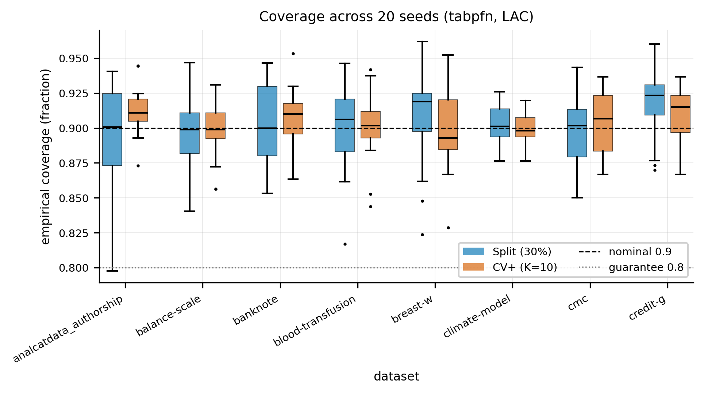
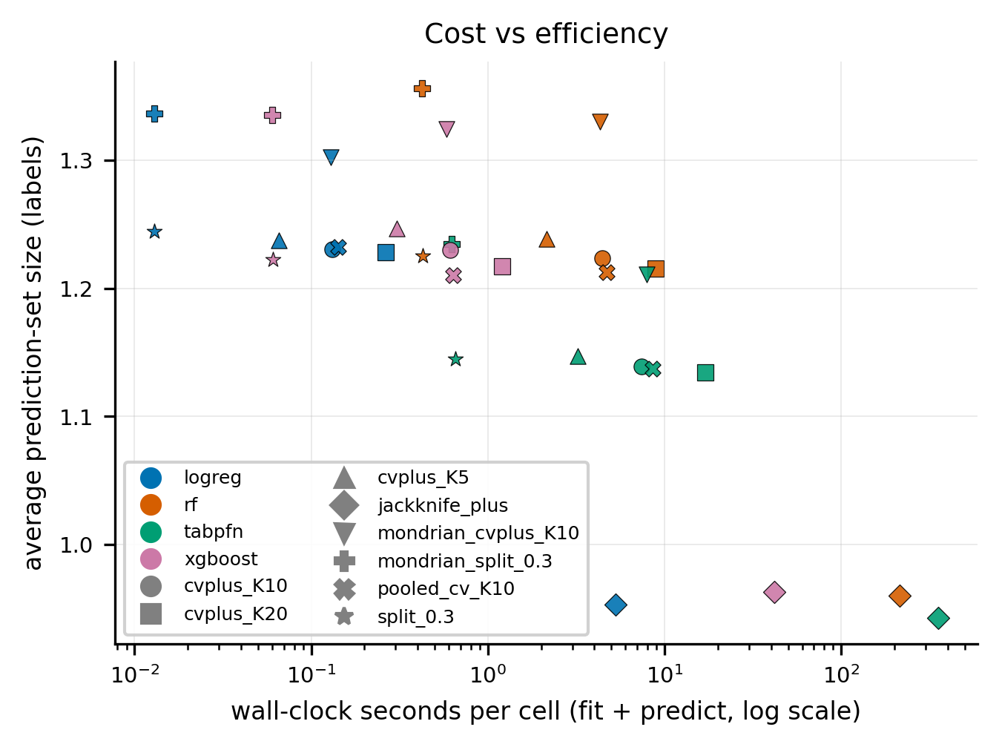

# Cheap Reliability

**Rethinking conformal prediction for tabular foundation models on small data**

[](https://www.python.org/)
[](LICENSE)
[](tests/)

Code, measurements and paper artifacts for the paper *Cheap Reliability: Rethinking Conformal Prediction for Tabular Foundation Models on Small Data*, accepted for publication in 2026.

TabPFN does not train by gradient descent: `fit()` only stores the context set. The natural hypothesis is that cross-conformal methods such as CV+ and jackknife+, which need K refits, should therefore be almost free for it. We tested that hypothesis on 15 OpenML datasets in the small-data regime (n_train = 500), against XGBoost, Random Forest and logistic regression, with 8 conformal methods, 3 nonconformity scores, 3 miscoverage levels and 20 seeds per cell.

**The hypothesis does not survive measurement.** TabPFN's fit really is cheap, but CV+ also has to *predict* K times, and for an in-context learner prediction is where the cost lives. What CV+ does buy is a measurably more stable coverage, and Mondrian calibration removes almost all of the class-conditional coverage gap. The paper is framed around that trade-off.

<p align="center">
  
</p>

## Main findings

All numbers are from `results/all_results.parquet` (130,896 rows, 14,544 cells, 0 failures) and are regenerated by `make artifacts`.

| | Finding |
|---|---|
| **RQ1 — cost** | `fit` is only 22.8% of a Split-CP cell for TabPFN (87–91% for the tree models), yet its CV+/Split cost ratio is **11.3×** at K=10 (XGBoost 10.1×, RF 10.4×) and **25.9×** at K=20 (20.3× baseline mean). The K-fold multiplier moves from training to inference; it does not disappear. |
| **RQ2 — stability** | CV+ (K=10) lowers the across-seed standard deviation of coverage on **14 of 15** datasets; median sd(Split)/sd(CV+) = **1.27×** (Wilcoxon p = 0.0009). |
| **RQ3 — calibration budget** | The set-size-optimal calibration fraction is ρ\* = **0.20** for TabPFN and 0.30 for XGBoost. |
| **RQ4 — conservativeness** | CV+ is guaranteed only 1−2α = 0.80, but its empirical coverage is 0.905 (K=10, binary), i.e. close to the nominal 0.90. |
| **RQ5 — class-conditional coverage** | Mondrian CV+ shrinks the mean class-conditional coverage gap from **0.340 to 0.057** (narrower in 20 of 20 comparisons) at the cost of larger sets (1.217 vs 1.098). |
| **RQ6 — sample size** | Over n_train ∈ {100, …, 800}, Split never catches up with CV+ on coverage stability. |

<p align="center">
  
</p>

## What is in the box

**Conformal methods** (`src/conformal_tabpfn/conformal.py`): Split, Mondrian Split, CV+, Mondrian CV+, pooled-CV, jackknife+, and the regression intervals. The conformal quantile is the exact k-th order statistic, computed with `np.partition` (see [NOTES.md](NOTES.md) §D1 for why `np.quantile(..., method="higher")` is off by one order statistic, and why `inverted_cdf` is not a safe substitute).

**Nonconformity scores** (`scores.py`): LAC, APS and RAPS, with the U-randomisation draw.

**Models** (`models.py`): TabPFN v2 (with a CUDA out-of-memory fallback), XGBoost, Random Forest, logistic regression, all behind one interface with global class alignment.

**Metrics and statistics** (`metrics.py`, `stats.py`): marginal and class-conditional coverage, set size, SSCV, ECE; Wilcoxon signed-rank with Holm correction, mean ranks and Nemenyi critical differences.

**Datasets**: 15 OpenML classification tasks (n = 540–1,941, 2–4 classes, imbalance ratio up to 10.7), listed in `configs/datasets_clf.yaml` with their OpenML ids.

## Correctness gates

`pytest tests/ -q` runs 147 tests in well under a minute (7 are skipped when TabPFN weights or a GPU are absent). The ones that matter most:

- `test_quantile.py`: the conformal quantile is the exact k-th order statistic; interpolating methods are rejected and the `inverted_cdf` shortcut is shown to be unsafe.
- `test_coverage_synthetic.py`: end-to-end coverage with the exact Bayes posterior as the model, so any deviation from 1−α comes from the conformal machinery alone; vectorised CV+ is checked against a naive reference.
- `test_exchangeability.py`: the harness must *detect* a deliberately leaked calibration set. A suite that stays green under a leak is not sensitive enough to trust.
- `test_mondrian.py`: Mondrian Split and Mondrian CV+ close the per-class coverage gap, including classes with no training points.
- `test_determinism.py`: same cell and seed give bit-identical metrics, and probability columns stay globally aligned when a class is missing from a fold (the check that caught a real XGBoost label-ordering bug during the study).

## Reproducing the study

```bash
python -m venv .venv && source .venv/bin/activate      # Windows: .venv\Scripts\activate
pip install torch==2.7.0 --index-url https://download.pytorch.org/whl/cu126
make setup        # pinned dependencies + editable install
make download     # the only networked step: OpenML datasets and TabPFN weights
make test         # correctness gates
make smoke        # ~60 s end-to-end sanity check
make reproduce    # every stage of the study, resumable
```

Measured on a laptop with an RTX 2060 (6 GB) and 32 GB RAM: about 10.5 GPU/CPU-hours of model time in total. Peak VRAM for TabPFN at n_train = 500 was 0.11 GB, so a smaller GPU or a CPU-only machine also works (slower).

To analyse the shipped measurements without re-running anything:

```python
import pandas as pd
df = pd.read_parquet("results/all_results.parquet")   # one row per (cell, score, alpha)
```

Every row carries the full cell key (dataset, model, CP method, score, α, seed, n_train, study), every metric, fit and predict timings, the device used and the version of every package that could change a number.

## Repository layout

```
configs/      datasets_clf.yaml, experiment.yaml (every constant of the grid)
src/conformal_tabpfn/
              scores  conformal  metrics  models  data  runners  experiment  stats  utils
scripts/      download_assets · smoke_test · run_experiments · run_budget_sweep
              run_crossover · consolidate_results · make_paper_artifacts · reproduce_all.sh
tests/        correctness gates
results/      all_results.parquet (all measurements)
paper/        figures/ (PDF + PNG), tables/ (LaTeX), results_summary.md, reproducibility.json
NOTES.md      every deviation from the original protocol, with the evidence behind it
```

## Citation

The paper has been accepted; the full reference will be added here when the proceedings are published.

## License

Code is released under the [MIT License](LICENSE). The datasets are fetched from OpenML under their own terms and are not redistributed here.
